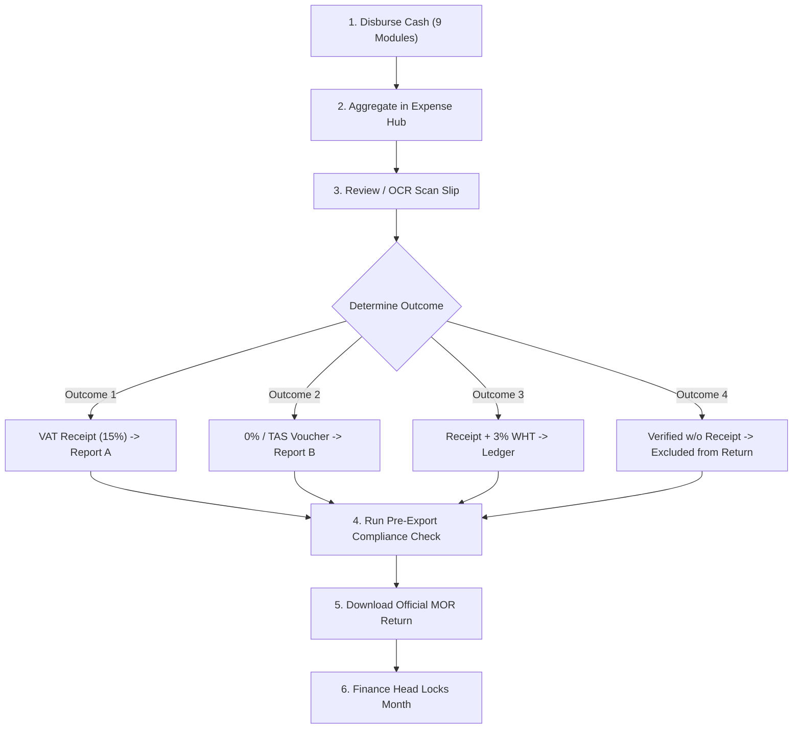

# Expense Hub & Tax Deductions User Guide

This guide details the complete monthly tax compliance, receipt verification, and export workflow for **Wechecha Construction ERP**, fully aligned with the Ministry of Revenue (MOR/ERCA) tax declaration standards.

---

## 1. System Overview

The **Expense Hub** (`/finance/expense-hub`) is the central cash-disbursement aggregator and tax decision engine for Wechecha Construction. It automatically consolidates all cash and bank disbursements across 9 ERP modules:

1. **ExpenseRequest** (Cash & bank general expenses)
2. **ProcurementPayment** (Purchase Request material cash payments)
3. **CreditStorePayment** (Settlement of credit store balances)
4. **PettyCashMaterialPurchase** (Site petty cash purchases)
5. **VehicleFuelRequest** (Fleet & equipment fuel purchases)
6. **IpcRecord** (Certified subcontractor payments)
7. **EmployeeAdvance** (Salary advances)
8. **Payroll** (Monthly staff payroll)
9. **FixedAsset** (CapEx asset acquisitions)

All rows start in the **Pending Verification** state and are strictly excluded from verified VAT and TAS totals until audited by Finance.

---

## 2. Monthly Tax Workflow Step-by-Step

### Step 1: Filter the Operating Cycle
1. Navigate to `/finance/expense-hub`.
2. Select the current Gregorian or Ethiopian month (e.g., `2026-03` / `Megabit 2018`).
3. View the **Summary KPI Cards** at the top:
   - **Total Disbursed Cash**
   - **Verified Input VAT (15%)**
   - **Declared 0% TAS Purchases**
   - **Verified Without Receipt (Audit Only)**
   - **Pending Verification (Requires Action)**
   - **Withholding Tax Deductions (3%)**

### Step 2: Upload or Scan Receipts
On any row in the Hub:
1. Click the **Actions** button (`...`) and choose **Add Receipt** or **Side-by-Side OCR Review**.
2. Upload the fiscal cash receipt (image or PDF).
3. The system automatically runs the AI OCR Vision Pipeline to detect:
   - 10-digit Vendor TIN
   - Buyer TIN (`0038480010` for Wechecha Construction)
   - FS Number (Fiscal Slip #)
   - MRC (Machine Registration Code)
   - Receipt Date
   - Subtotal, VAT Amount (15%), and Total Amount
   - Multi-line receipt items

---

## 3. The 4 Verification Outcomes

| Outcome | Classification | Rate | Required Data | Included in Declarations? |
| :--- | :--- | :--- | :--- | :--- |
| **Outcome 1** | **With VAT Receipt** | 15% | 10-digit TIN, FS No, MRC, Date | **Yes -> Report A (15-Col Purchase VAT Return)** |
| **Outcome 2** | **Without VAT Receipt (TAS)** | 0% | Vendor TIN / Voucher No, Reason | **Yes -> Report B (9-Col e-Tax Purchase TAS Return)** |
| **Outcome 3** | **Receipt + Withholding** | 15% VAT + 3% WHT | 10-digit TIN, FS No, WHT Slip | **Yes -> Report A & Tax Deductions WHT Ledger** |
| **Outcome 4** | **Verified Without Receipt** | 0% Non-Tax | Mandatory audit reason note | **NO (Strictly excluded from VAT & TAS Returns)** |

### Handling Outcome 1: With VAT Receipt
1. Verify that the receipt has a valid machine-printed **FS No** and **MRC**.
2. Ensure the **Vendor TIN** is exactly 10 digits.
3. The system verifies that `VAT Amount == Subtotal * 0.15` (within 1 ETB rounding).
4. Save the decision. The expense is credited to input VAT and scheduled for ERCA Line 100 deduction (or Line 65 if Fixed Asset).

### Handling Outcome 2: Without VAT Receipt (0% TAS)
1. Used for fuel station exempt receipts, government fees, utilities, or 0% tax invoices.
2. Select justification (e.g., `fuel_zero_vat`, `tas_purchase`, or `utility_bill`).
3. Enter receipt reference number or cash voucher code.
4. Saving automatically adds the row to the **e-Tax 9-Column TAS Declaration**.

### Handling Outcome 3: With Receipt and Withholding (3%)
1. In the decision modal, check **Withholding Tax (3%)**.
2. The system automatically computes 3% on the pre-tax base amount:
   $$\text{WHT Amount} = \text{Base Amount} \times 0.03$$
   $$\text{Net Disbursed to Vendor} = \text{Total Amount} - \text{WHT Amount}$$
3. Attach the scanned **Withholding Tax Slip** and record the slip number.
4. The withholding record syncs directly to the **Withholding Tax Deductions Ledger** (`/finance/tax-deductions`).

### Handling Outcome 4: Verified Without Receipt
1. Used for legitimate site operations where no formal receipt can be obtained (e.g., informal day-labor porter, rural local materials).
2. Click **Verified Without Receipt** from the row menu.
3. Select justification and enter a mandatory **Audit Memo / Reason Note**.
4. **Compliance Guarantee**: The system marks the row as audited and operational, but **strictly excludes** it from both the 15-column Purchase VAT return and the 9-column TAS declaration, protecting the company from ERCA audit penalties.

---

## 4. Side-by-Side OCR Review & Low-Confidence Handling

When reviewing receipts:
- The **Side-by-Side OCR Review Screen** presents the original receipt document (PDF or image) on the left panel with rotate and full-size zoom controls.
- Extracted tax fields appear on the right panel.
- **Amber Border Highlighting**: Any field with an OCR confidence score below 70% is bordered in amber (`#fd7e14`) with a soft amber background. Reviewers must double-check these fields against the document on the left.
- **Duplicate Receipt Alert**: If an FS Number and TIN already exist in the database, a red alert banner prevents duplicate tax credit claims.
- **Discrepancy Confirmation**: If the OCR total differs from the cash disbursed amount, the user must check the confirmation box acknowledging the difference before saving.
- **Multi-Line Receipt Items**: Items can be edited, added, or deleted directly in the table.
- **OCR Failure Fallback**: If an image is blurry or unsupported, the reviewer can manually enter the values directly into the right panel.

---

## 5. Pre-Export Compliance Check

Before exporting official tax declarations:
1. Click **Official VAT Report (15 Cols)** or **Purchase TAS Excel (9 Cols)**.
2. The system automatically runs the **Pre-Export Validation Check**:
   - Verifies all rows have a 10-digit TIN.
   - Verifies FS Number / Receipt Number is present.
   - Verifies MRC Number is present (for VAT returns).
   - Verifies Disbursement / Receipt Date is present.
3. If any rows are missing required fields, the **Pre-Export Compliance Modal** opens:
   - Displays each incomplete record with its reference number, vendor, amount, and missing fields.
   - Click **Fix** next to any record to open the verification dialog and complete the missing information.
   - Once all rows are valid, the download proceeds automatically.

---

## 6. Official Reports Summary

1. **Report A: Official 15-Column Purchase VAT Return (`Purchase_VAT_Declaration_*.csv`)**
   - Strictly Outcome 1 records.
   - CapEx Fixed Asset purchases mapped to **Line 65** (`purchase_type = 1`).
   - Local taxable inputs mapped to **Line 100** (`purchase_type = 3`).
   - Exact MOR headers in UTF-8 BOM CSV format for direct e-Tax filing.

2. **Report B: Official 9-Column e-Tax Purchase TAS Declaration (`Purchase_TAS_*.xlsx / *.csv`)**
   - Strictly Outcome 2 records (excludes Outcome 4).
   - Columns: `Purchaser TIN`, `Seller TIN`, `Amount`, `Receipt No`, `Receipt Date`, `Encoding Date`, `MRC`, `PurcType`, `Encoded By`.

3. **Report C: 13-Column Sales Return (`Sales_Report_*.xlsx`)**
   - Generated from `IncomeRecord` client progress billings.

4. **Report D: 22-Column Master Corporate Tax Audit (`Expense_Hub_Export_*.csv`)**
   - Internal audit format capturing all 4 outcomes, payment methods, WHT slips, and compliance warnings.

---

## 7. Monthly Settlement & Row Locking

1. At month-end, the Finance Head reviews the Monthly VAT Breakdown.
2. Once verified, click **Lock Month**.
3. All rows for that month are frozen and cannot be modified by operational staff.
4. To unlock a closed month, a user with the `finance_head` role must provide a mandatory audit reason, which is permanently logged in `ExpenseHubVatAuditLog`.
