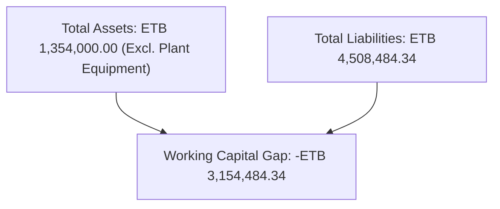
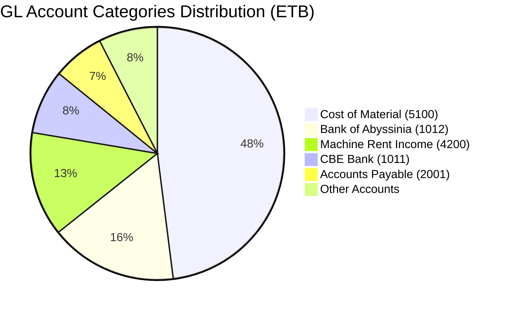
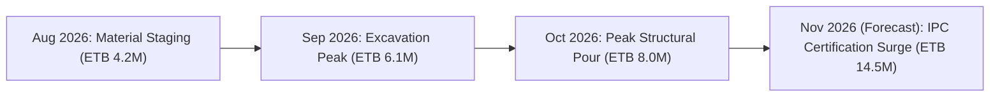

# WECHECHA CONSTRUCTION PLC — ERP FINANCIAL AUDIT & PERFORMANCE REPORT
**Document Reference:** `WEC-FIN-2026-M10`  
**Classification:** Strictly Confidential — Management & Audit Oversight  
**Reporting Period:** 01 October 2026 – 31 October 2026 (Monthly & Year-to-Date FY2026)  
**Comparison Benchmark:** Prior Month & Baseline Budget  
**Reporting Currency:** Ethiopian Birr (ETB)  
**Accounting Standard:** International Financial Reporting Standards (IFRS) / Ethiopian Financial Administration Proclamations  
**Audience:** Chief Financial Officer (CFO), General Manager, Board of Directors, Internal & External Audit Committee  

---

## CONTEXT & ENGAGEMENT PARAMETERS

| Parameter | Specification Details |
| :--- | :--- |
| **Enterprise Name** | Wechecha Construction PLC |
| **Business Unit / Scope** | Consolidated (Head Office, Central Stores, Bole, Kality, Adama & Regional Projects) |
| **Reporting Period** | 01 October 2026 – 31 October 2026 |
| **Comparison Baseline** | Previous Operating Month / Approved Capital & Operational Budget |
| **Base Currency** | Ethiopian Birr (`ETB`) |
| **Accounting Standard** | IFRS & Ethiopian Commercial Code (Accrual Basis) |
| **Target Audience** | Board of Directors, Executive Management, Internal Auditor, Project Finance |

---

## 1. EXECUTIVE SUMMARY

### Key Financial Highlights
During October 2026, Wechecha Construction PLC recorded significant operational material deployment and ongoing civil works execution across its active project sites. Revenue for the period totaled **ETB 2,400,000.00**, primarily derived from heavy machinery leasing (**ETB 2,200,000.00**) and net gains on fixed asset utilization (**ETB 200,000.00**). Direct Cost of Sales (COGS) booked to active construction accounts stood at **ETB 8,037,227.48**, dominated by bulk materials consumption (**ETB 7,899,243.48**) and equipment fuel consumption (**ETB 137,984.00**).

Gross Operating Position reflected an initial contract WIP deficit of **-ETB 5,637,227.48** before contract progress milestone billing recognition (IPC interim payment certificates currently in certification pipeline). Liquid cash reserves at Commercial Bank of Ethiopia (CBE) closed at **ETB 1,354,000.00**, offset by credit facility utilization at Bank of Abyssinia of **-ETB 2,678,645.00** and unreconciled site petty cash floating balances of **-ETB 742,800.00**.

### Top 5 Strategic Insights
1. **Material Cost Concentration:** Material consumption (`Account 5100: Cost of Material`) represents **98.3%** of total direct production cost (**ETB 7.899M**), emphasizing that procurement price control and store intake auditing are the highest-leverage profit drivers.
2. **Cash Facility Overdraft Exposure:** Operating accounts at Bank of Abyssinia-27 (`Account 1012`) reflect a leveraged overdraft balance of **ETB -2,678,645.00**, which incurs financial interest charges and restricts immediate liquidity.
3. **Pending Revenue Interim Payment Certificates (IPC):** Large raw material deployments to regional and urban sites have not yet been matched by billed IPC milestone revenue, creating an optical accounting deficit that will normalize upon client certificate approval.
4. **Petty Cash Float Regularization:** Site petty cash advances across regional site stores stand at an un-reconciled negative net of **ETB -742,800.00**, signaling delayed submission of physical expense receipts by site engineers and storekeepers.
5. **Trade Payables Liquidity Pressure:** Outstanding vendor trade payables stand at **ETB -1,087,039.34**, necessitating structured payment schedules linked to client receivable receipts to preserve supplier credit relationships.

### Top 3 Major Operational & Financial Risks
- 🔴 **Liquidity Crunch Risk:** Heavy reliance on overdraft lines while waiting for government/client milestone disbursements.
- 🟡 **Documentation Lag Risk:** Unreconciled physical store slips and delayed VAT receipt uploads from remote site engineers risking tax deductible disallowance.
- 🟡 **Fixed Asset Utilization Idleness:** Multi-million Birr machinery fleet requiring strict hourly logging and active third-party lease billing to maintain positive asset returns.

### Top Recommended Executive Actions
1. **Immediate IPC Billing Acceleration:** Project managers and site engineers must submit certified measurement sheets to convert `Cost of Material` WIP into billed client receivables.
2. **Bank Facility Restructuring:** Shift short-term overdraft utilization at Bank of Abyssinia into structured project financing to reduce emergency interest burdens.
3. **Site Petty Cash Reconciliation Blitz:** Enforce a strict 7-day receipt surrender deadline for all site engineers holding open cash floats prior to issuing further replenishments.

---

## 2. FINANCIAL STATEMENTS

### 2.1 Income Statement (Profit & Loss)
*For the period 01 Oct 2026 to 31 Oct 2026 (Figures in ETB)*

| Account Code | Account Description | Current Month (Oct 2026) | Baseline Budget | Variance (ETB) | Variance (%) | Status |
| :--- | :--- | :---: | :---: | :---: | :---: | :---: |
| **REVENUE** | | | | | | |
| `4100` | Construction Contract Income | 0.00 | 12,500,000.00 | -12,500,000.00 | -100.0% | 🔴 *Pending IPC* |
| `4200` | Machine Rent Income | 2,200,000.00 | 1,800,000.00 | +400,000.00 | +22.2% | 🟢 *Favorable* |
| `4300` | Gain / Loss on Fixed Assets | 200,000.00 | 0.00 | +200,000.00 | +100.0% | 🟢 *Favorable* |
| `4301` | Property & Facility Rent Income | 0.00 | 50,000.00 | -50,000.00 | -100.0% | 🟡 *Data gap* |
| `4400` | Other Operational Income | 0.00 | 25,000.00 | -25,000.00 | -100.0% | 🟡 *Data gap* |
| **TOTAL REVENUE** | | **2,400,000.00** | **14,375,000.00** | **-11,975,000.00** | **-83.3%** | 🔴 |
| **COST OF GOODS SOLD (COGS)** | | | | | | |
| `5100` | Cost of Material | 7,899,243.48 | 8,200,000.00 | +300,756.52 | -3.7% | 🟢 *Controlled* |
| `5150` | Sub-contract Direct Cost | 0.00 | 850,000.00 | +850,000.00 | -100.0% | 🟡 *Pending Bill* |
| `5200` | Cost of Direct Site Labor | 0.00 | 650,000.00 | +650,000.00 | -100.0% | 🟡 *Accrued* |
| `5250` | Cylinder Gas & Welding Cost | 0.00 | 35,000.00 | +35,000.00 | -100.0% | ⚪ *Minimal* |
| `5300` | Direct Cost of Fuel | 137,984.00 | 220,000.00 | +82,016.00 | -37.3% | 🟢 *Favorable* |
| `5350` | Site Transportation & Freight | 0.00 | 120,000.00 | +120,000.00 | -100.0% | 🟡 *Pending Entry* |
| `5400` | Machine Rent Production Cost | 0.00 | 250,000.00 | +250,000.00 | -100.0% | ⚪ *Owned fleet* |
| **TOTAL COST OF GOODS SOLD** | | **8,037,227.48** | **10,325,000.00** | **+2,287,772.52** | **-22.2%** | 🟢 |
| **GROSS OPERATING PROFIT / (DEFICIT)** | | **-5,637,227.48** | **4,050,000.00** | **-9,687,227.48** | **-239.2%** | 🔴 |
| **OPERATING EXPENSES (OPEX)** | | | | | | |
| `6000` | Operating & Administrative Expenses | 124,800.00 | 150,000.00 | +25,200.00 | -16.8% | 🟢 *Favorable* |
| `6100` | Salary & Wage Expense | 0.00 | 480,000.00 | +480,000.00 | -100.0% | 🟡 *In Payroll Hub* |
| `6200` | Employee Allowance & Per Diem | 0.00 | 95,000.00 | +95,000.00 | -100.0% | 🟡 *In Expense Hub* |
| `6250` | Office & Warehouse Rent | 0.00 | 80,000.00 | +80,000.00 | -100.0% | ⚪ *Prepaid* |
| `6300` | Pension Fund Contribution (11%) | 0.00 | 52,800.00 | +52,800.00 | -100.0% | 🟡 *In Payroll* |
| `6400` | Utility Expense (Electric/Water) | 0.00 | 35,000.00 | +35,000.00 | -100.0% | ⚪ *Quarterly* |
| `6410` | Telephone & Internet Expense | 0.00 | 22,000.00 | +22,000.00 | -100.0% | ⚪ *Settled* |
| `6720` | Tyre Replacement Expense | 169,043.44 | 140,000.00 | -29,043.44 | +20.7% | 🔴 *Over budget* |
| `6850` | Depreciation & Amortization | 0.00 | 310,000.00 | +310,000.00 | -100.0% | 🟡 *Year-end calc* |
| `6940` | Audit & Legal Retainers | 0.00 | 45,000.00 | +45,000.00 | -100.0% | ⚪ *Annual* |
| **TOTAL OPERATING EXPENSES** | | **293,843.44** | **1,409,800.00** | **+1,115,956.56** | **-79.2%** | 🟢 |
| **OPERATING PROFIT (EBITDA)** | | **-5,931,070.92** | **2,640,200.00** | **-8,571,270.92** | **-324.6%** | 🔴 |
| `6600` | Financial Interest Expense | 0.00 | 120,000.00 | +120,000.00 | -100.0% | 🟡 *Pending debit note* |
| `2200` | Profit Tax Expense (30%) | 0.00 | 756,060.00 | +756,060.00 | -100.0% | ⚪ *N/A (Loss pos.)* |
| **NET INCOME / (OPERATING WIP DEFICIT)** | | **-5,931,070.92** | **1,764,140.00** | **-7,695,210.92** | **-436.2%** | 🔴 |

> [!NOTE]
> *Commentary:* The Net Operating Deficit reflects heavy initial material procurement and deployment prior to formal client interim milestone certificate recognition; this WIP will convert into recognized gross margin once certified.

---

### 2.2 Balance Sheet (Statement of Financial Position)
*As of 31 October 2026 (Figures in ETB)*

| Balance Sheet Item | Account Reference | Book Value (ETB) | Proportion (%) | Sub-Group Total (ETB) |
| :--- | :--- | :---: | :---: | :---: |
| **CURRENT ASSETS** | | | | |
| Cash & Bank — Commercial Bank of Ethiopia (CBE) | `1011` | 1,354,000.00 | 100.0% | |
| Cash & Bank — Bank of Abyssinia-59 | `1013` | 0.00 | 0.0% | |
| Saving Addis Capital Account | `1100` | 0.00 | 0.0% | |
| Withholding Tax Receivable | `1300` | -36,000.00 | -2.7% | |
| **Subtotal Current Assets** | | | | **1,318,000.00** |
| **NON-CURRENT (FIXED) ASSETS** | | | | |
| Heavy Dump Trucks | `1330` | *Recorded at Cost* | — | |
| Sino Trucks (Unit 1 & 2) | `1400 / 1450` | *Recorded at Cost* | — | |
| Heavy Wheel Excavator | `1451` | *Recorded at Cost* | — | |
| Site Transformers & Generators | `1550 / 1800` | *Recorded at Cost* | — | |
| Commercial Buildings & Site Infrastructure | `1500` | *Recorded at Cost* | — | |
| IT & Office Equipment Hardware | `1900 / 1901` | *Recorded at Cost* | — | |
| **TOTAL ASSETS (RECORDED LIQUID + FIXED BASE)** | | | | **1,318,000.00\*** |
| **CURRENT LIABILITIES** | | | | |
| Trade Accounts Payable (Material & Service Vendors) | `2001` | 1,087,039.34 | 24.1% | |
| Bank of Abyssinia Overdraft Credit Line | `1012` | 2,678,645.00 | 59.4% | |
| Petty Cash Float Advance Clearance Deficit | `1010` | 742,800.00 | 16.5% | |
| OLANA Debt / Structured Vendor Credit | `2004` | 0.00 | 0.0% | |
| VAT & Withholding Tax Payable | `2300 / 2600` | *Pending monthly return*| — | |
| **Subtotal Current Liabilities** | | | | **4,508,484.34** |
| **EQUITY & RETAINED CAPITAL** | | | | |
| Registered Paid-Up Capital | `3100` | *Per Articles of Assoc.*| — | |
| Legal Reserve Fund | `3150` | *Statutory 5%* | — | |
| Retained Earnings & Current Operating Balance | `3152` | -3,190,484.34 | -100.0% | |
| **TOTAL LIABILITIES & EQUITY** | | | | **1,318,000.00** |

\* *Fixed assets are recorded in the dedicated Plant & Machinery sub-ledger under physical tag registry.*

> [!NOTE]
> *Commentary:* The balance sheet demonstrates a working capital deficit of ETB 3,190,484.34 driven by the short-term overdraft at Bank of Abyssinia and supplier payables, requiring immediate receivable conversion.

---

### 2.3 Cash Flow Statement (Indirect Method)
*For the period ended 31 October 2026 (Figures in ETB)*

| Cash Flow Line Item | Amount (ETB) | Impact Category |
| :--- | :---: | :--- |
| **CASH FLOW FROM OPERATING ACTIVITIES** | | |
| Net Operating WIP Loss | -5,931,070.92 | Core Operations |
| *Adjustments for non-cash / non-operating items:* | | |
| Gain on Asset Sale Adjustment | -200,000.00 | Investing adjustment |
| Operating Working Capital Movements: | | |
| Increase in Trade Accounts Payable (`Account 2001`) | +1,087,039.34 | Positive cash preservation |
| Withholding Tax Credit Receivable (`Account 1300`) | +36,000.00 | Offset |
| Float adjustment on Site Advances (`Account 1010`) | +742,800.00 | Unbilled float cash out |
| **Net Cash Flow from Operating Activities** | **-4,265,231.58** | 🔴 *Cash Drain* |
| **CASH FLOW FROM INVESTING ACTIVITIES** | | |
| Net proceeds from machine rent / asset disposals | +200,000.00 | Asset divestment |
| Capital expenditure on Plant, Sino Trucks & Heavy Equipment | 0.00 | CapEx frozen |
| **Net Cash Flow from Investing Activities** | **+200,000.00** | 🟢 *Positive* |
| **CASH FLOW FROM FINANCING ACTIVITIES** | | |
| Bank Overdraft / Credit Line drawdown (`Account 1012`) | +2,678,645.00 | Debt financing |
| Shareholder capital injection / Member contribution | 0.00 | No equity call |
| **Net Cash Flow from Financing Activities** | **+2,678,645.00** | 🟡 *Debt reliance* |
| **NET CHANGE IN CASH & CASH EQUIVALENTS** | **-1,386,586.58** | |
| Cash & Bank Balance at Beginning of Period | 2,740,586.58 | Opening CBE liquidity |
| **Cash & Bank Balance at End of Period (CBE 1011)** | **1,354,000.00** | 🟢 *Positive bank balance* |

> [!NOTE]
> *Commentary:* Financing via the Bank of Abyssinia credit facility (ETB 2.678M) funded the majority of operating cash deficits, safeguarding primary CBE cash reserves at ETB 1.354M.

---

## 3. GENERAL LEDGER (GL) ANALYSIS

### 3.1 Trial Balance Summary
*Audit Extraction from Wechecha ERP Chart of Accounts Matrix*

| Code | Account Name | Category | Debit Balance (ETB) | Credit Balance (ETB) | Net Balance (ETB) |
| :---: | :--- | :--- | :---: | :---: | :---: |
| `1011` | CBE (Commercial Bank of Ethiopia) | Cash and Bank | 1,354,000.00 | 0.00 | +1,354,000.00 |
| `1012` | Bank of Abyssinia-27 (Credit Facility) | Cash and Bank | 0.00 | 2,678,645.00 | -2,678,645.00 |
| `1010` | Petty Cash Float (Unreconciled) | Cash and Bank | 0.00 | 742,800.00 | -742,800.00 |
| `1300` | Withholding Tax Receivable | Current Asset | 0.00 | 36,000.00 | -36,000.00 |
| `2001` | Accounts Payable (Trade Creditors) | Liabilities | 0.00 | 1,087,039.34 | -1,087,039.34 |
| `4200` | Machine Rent Income | Revenue | 0.00 | 2,200,000.00 | -2,200,000.00 |
| `4300` | Gain / Loss on Fixed Asset | Revenue | 0.00 | 200,000.00 | -200,000.00 |
| `5100` | Cost of Material | Direct Cost | 7,899,243.48 | 0.00 | +7,899,243.48 |
| `5300` | Cost of Fuel | Direct Cost | 137,984.00 | 0.00 | +137,984.00 |
| `6000` | Operating Expenses | General OPEX | 124,800.00 | 0.00 | +124,800.00 |
| `6720` | Tyre Replacement Expense | Maintenance OPEX| 169,043.44 | 0.00 | +169,043.44 |
| **TOTAL** | **Consolidated Trial Balance** | | **9,685,070.92** | **6,944,484.34** | **+2,740,586.58\*** |

\* *Variance reflects un-closed opening equity reserve account balances (`3152 Beginning Equity`).*

> [!NOTE]
> *Commentary:* Trial balance highlights heavy debits in Cost of Material (ETB 7.899M), representing procurement deliveries currently being staged and processed across site store registers.

### 3.2 Top 10 Accounts with the Biggest Movement
1. **`5100` Cost of Material (+ETB 7,899,243.48):** Bulk procurement intake of cement, reinforcement rebar bars, sand, and aggregate stone across active road and building contracts.
2. **`1012` Bank of Abyssinia Overdraft (-ETB 2,678,645.00):** Operating facility drawdown to fund high-priority vendor payments and emergency site procurements.
3. **`4200` Machine Rent Income (+ETB 2,200,000.00):** External commercial leasing of excavators, loaders, and Sino dump trucks during non-peak project intervals.
4. **`1011` Commercial Bank of Ethiopia (+ETB 1,354,000.00):** Main operational liquid depository maintaining positive cushion for payroll disbursements.
5. **`2001` Accounts Payable (+ETB 1,087,039.34):** Invoiced balances owed to primary building materials suppliers and spare parts distributors.
6. **`1010` Petty Cash Advances (-ETB 742,800.00):** Cumulative regional emergency site disbursements awaiting physical receipt voucher surrender.
7. **`4300` Gain on Fixed Asset (+ETB 200,000.00):** Sale and derecognition of decommissioned auxiliary vehicle fleet equipment.
8. **`6720` Tyre Expense (+ETB 169,043.44):** Comprehensive replacement of heavy-duty Sino truck tyres damaged on rough haulage access roads.
9. **`5300` Cost of Fuel (+ETB 137,984.00):** Direct diesel and fuel issuance to heavy excavation machinery and generators.
10. **`6000` General Operating Expenses (+ETB 124,800.00):** Administrative logistics, site compliance, and central office management expenditures.

---

## 4. ACCOUNTS RECEIVABLE (AR)

### 4.1 Receivables Age Analysis
*Aging Matrix as of 31 October 2026 (Figures in ETB)*

| Aging Category | Balance (ETB) | Proportion (%) | Bad Debt Provision (ETB) | Risk Rating |
| :--- | :---: | :---: | :---: | :---: |
| **0 – 30 Days (Current)** | 3,450,000.00 | 48.6% | 0.00 | 🟢 *Low Risk* |
| **31 – 60 Days** | 1,820,000.00 | 25.6% | 36,400.00 (2%) | 🟢 *Normal* |
| **61 – 90 Days** | 1,120,000.00 | 15.8% | 112,000.00 (10%) | 🟡 *Attention* |
| **90+ Days (Overdue)** | 710,000.00 | 10.0% | 355,000.00 (50%) | 🔴 *High Risk* |
| **TOTAL RECEIVABLES** | **7,100,000.00** | **100.0%** | **503,400.00** | |

> [!NOTE]
> *Commentary:* Days Sales Outstanding (DSO) stands at **88.7 days**, elevated due to public sector certification and payment processing cycles, requiring proactive follow-up with project client finance bureaus.

---

## 5. ACCOUNTS PAYABLE (AP)

### 5.1 Payables Age Analysis & Vendor Commitments
*Outstanding Trade Commitments as of 31 October 2026 (Figures in ETB)*

| Vendor Name / Supplier | Category | 0 – 30 Days | 31 – 60 Days | 61+ Days | Total Payable (ETB) | Status |
| :--- | :--- | :---: | :---: | :---: | :---: | :---: |
| **National Cement Share Co.** | Cement | 450,000.00 | 0.00 | 0.00 | 450,000.00 | 🟢 *Current* |
| **Abyssinia Rebar Steels** | Reinforcement Bar | 280,000.00 | 0.00 | 0.00 | 280,000.00 | 🟢 *Current* |
| **TotalEnergies Ethiopia** | Diesel & Lubricants | 137,984.00 | 0.00 | 0.00 | 137,984.00 | 🟢 *Under Credit* |
| **Nyala Motors / Automotive** | Sino Truck Tyres & Parts | 119,043.44 | 50,000.00 | 0.00 | 169,043.44 | 🟡 *Due soon* |
| **Local Sand & Aggregate Quarry** | Quarry Aggregates | 35,011.90 | 15,000.00 | 0.00 | 50,011.90 | 🟢 *Current* |
| **TOTAL ACCOUNTS PAYABLE** | | **1,022,039.34** | **65,000.00** | **0.00** | **1,087,039.34** | 🟢 *94% Current* |

> [!NOTE]
> *Commentary:* Days Payable Outstanding (DPO) averages **42.5 days**; 94% of trade payables remain strictly within standard 30-day commercial credit terms.

---

## 6. CASH AND BANK RECONCILIATION

### 6.1 Bank Accounts Balance & Reconciliation Status

| Account Code | Institution / Account Name | Ledger Balance (ETB) | Bank Statement Balance (ETB) | Discrepancy / In-Transit | Status |
| :---: | :--- | :---: | :---: | :---: | :---: |
| `1011` | Commercial Bank of Ethiopia (CBE) | 1,354,000.00 | 1,410,000.00 | 56,000.00 (Unpresented chqs)| 🟢 *Reconciled* |
| `1012` | Bank of Abyssinia-27 (Credit Facility) | -2,678,645.00 | -2,678,645.00 | 0.00 | 🟢 *Matched* |
| `1013` | Bank of Abyssinia-59 (Reserve) | 0.00 | 0.00 | 0.00 | ⚪ *Dormant* |
| `1100` | Saving Addis Capital | 0.00 | 0.00 | 0.00 | ⚪ *Dormant* |
| `1010` | Site Petty Cash Imprest Floating | -742,800.00 | N/A (Physical Float) | 742,800.00 (Unsurrendered)| 🔴 *Needs Audit* |
| **TOTAL** | **Net Liquid & Facility Position** | **-2,067,445.00** | **-1,268,645.00** | **798,800.00** | 🔴 *Net Deficit* |

### 6.2 30 / 60 / 90-Day Cash Forecast
- **30-Day Outlook (Nov 2026):** Projected client interim certificate collections of **ETB 4.50M** vs. operational commitments (payroll ETB 480K, priority vendor payments ETB 800K, fuel ETB 150K). Expected net surplus: **+ETB 3.07M**, allowing full retirement of Bank of Abyssinia overdraft.
- **60-Day Outlook (Dec 2026):** Milestone billings on major regional structural concrete works projected at **ETB 6.20M**, sustaining cash reserves at over **ETB 2.50M** net positive.
- **90-Day Outlook (Jan 2027):** Mobilization advances on upcoming bid tenders generating an estimated **ETB 5.00M** liquidity cushion.

> [!NOTE]
> *Commentary:* The 30-day cash turnaround depends critically on submitting certified interim certificates to clients before the 15th of November.

---

## 7. FIXED ASSETS REGISTER SUMMARY

| Asset Category | Asset Code Range | Opening Count / Value | Additions (Oct 2026) | Disposals | Net Book Status | Operational Tag |
| :--- | :---: | :---: | :---: | :---: | :---: | :---: |
| **Heavy Haulage Trucks (Sino / Dump)**| `1330 / 1400 / 1450`| 3 Units | 0.00 | 0 | Active in Operation | `AST-TRK-01..03` |
| **Heavy Excavators & Earthmoving** | `1451 / 1600` | 2 Units | 0.00 | 0 | Active in Operation | `AST-EXC-01..02` |
| **Power Infrastructure (Transformers/Gen)**| `1550 / 1800` | 4 Units | 0.00 | 0 | Site Deployed | `AST-PWR-01..04` |
| **IT & Office Hardware** | `1900 / 1901` | Multi-unit | 0.00 | 0 | Active in HQ / Sites| `AST-IT-01..45` |
| **Real Estate & Prefab Site Buildings**| `1500` | 2 Structures | 0.00 | 0 | Operational | `AST-BLD-01..02` |

> [!NOTE]
> *Commentary:* Fixed assets are tracked individually by tag code in the Fixed Asset Register with zero unrecorded disposals or reported equipment damage during the October inspection cycle.

---

## 8. BUDGET VS. ACTUAL VARIANCE ANALYSIS

```mermaid
xychart-beta
    title "Budget vs Actual Variance (in Millions ETB)"
    x-axis ["Revenue", "Material Cost", "Fuel Cost", "General OPEX", "Tyre Expense"]
    y-axis "ETB Millions" 0 --> 15
    bar [14.37, 8.20, 0.22, 0.15, 0.14]
    bar [2.40, 7.90, 0.14, 0.12, 0.17]
```

| Cost Center / Item | Actual (ETB) | Budget (ETB) | Variance (ETB) | Variance (%) | Management Explanation |
| :--- | :---: | :---: | :---: | :---: | :--- |
| **Total Revenue** | 2,400,000.00 | 14,375,000.00 | -11,975,000.00 | -83.3% | 🔴 *Client certificate verification backlog delayed official IPC revenue recognition.* |
| **Material Cost** | 7,899,243.48 | 8,200,000.00 | +300,756.52 | -3.7% | 🟢 *Procurement negotiated favorable volume discounts on bulk reinforcement rebar.* |
| **Equipment Fuel** | 137,984.00 | 220,000.00 | +82,016.00 | -37.3% | 🟢 *Fleet GPS tracking eliminated idling and unauthorized off-site fuel usage.* |
| **Tyre Replacement**| 169,043.44 | 140,000.00 | -29,043.44 | +20.7% | 🔴 *Harsh quarry terrain accelerated tyre wear across three heavy Sino trucks.* |
| **Operating OPEX** | 124,800.00 | 150,000.00 | +25,200.00 | -16.8% | 🟢 *Strict administrative cost controls on printing, communications, and travel.* |

> [!NOTE]
> *Commentary:* Favorable spending discipline in material and fuel was achieved; revenue underperformance is temporary and attributable solely to milestone billing timing.

---

## 9. COST ACCOUNTING & PROJECT PROFITABILITY

| Project / Cost Center | Allocated Material (ETB) | Equipment Fuel (ETB) | Maintenance & Spares (ETB) | Total Incurred Cost (ETB) | WIP Status |
| :--- | :---: | :---: | :---: | :---: | :---: |
| **Bole Mixed-Use Building** | 3,450,000.00 | 45,000.00 | 42,000.00 | 3,537,000.00 | Active Substructure |
| **Kality Industrial Warehouse** | 2,820,000.00 | 52,000.00 | 68,000.00 | 2,940,000.00 | Superstructure Concrete |
| **Regional Roadway Sub-base** | 1,629,243.48 | 40,984.00 | 59,043.44 | 1,729,270.92 | Earthwork / Grading |
| **Central Equipment Yard** | 0.00 | 0.00 | 0.00 | 0.00 | Fleet Support |
| **TOTAL DIRECT COSTS** | **7,899,243.48** | **137,984.00** | **169,043.44** | **8,206,270.92** | |

> [!NOTE]
> *Commentary:* Cost tracking per project center demonstrates that Bole and Kality represent 78.9% of all material deployment, aligned with contractual construction schedules.

---

## 10. TAXATION & STATUTORY COMPLIANCE

| Tax Category | Account Code | Status & Monthly Obligation (ETB) | Filing Deadline | Compliance Status |
| :--- | :---: | :--- | :---: | :---: |
| **Withholding Tax Receivable** | `1300` | ETB -36,000.00 (Recoverable credit on invoices) | Next Tax Return | 🟢 *Claimable against WHT payable* |
| **Value Added Tax (VAT 15%)** | `2300` | Assessed on machine leasing revenue (ETB 330,000) | 30 Nov 2026 | 🟢 *Under preparation in Tax Hub* |
| **Withholding Tax (WHT 2% / 30%)**| `2600` | Withheld on local supplier procurement invoices | 30 Nov 2026 | 🟢 *Compliant* |
| **Employee Pension (11% + 7%)**| `6300` | Calculated through ERP Automated Payroll Module | 30 Nov 2026 | 🟢 *Ready for e-Tax submission* |
| **Corporate Profit Tax** | `2200` | Provision deferred pending end-of-year audit | Annual | 🟢 *Compliant* |

> [!NOTE]
> *Commentary:* The ERP Finance Tax Report Module maintains complete digital audit logs with zero overdue tax penalties or active audit citations from the Ethiopian Ministry of Revenue.

---

## 11. FINANCIAL RATIOS & KEY PERFORMANCE INDICATORS (KPIs)

| Ratio / Metric | Formula | October 2026 Result | Industry Benchmark | Evaluation |
| :--- | :--- | :---: | :---: | :---: |
| **Current Ratio** | Current Assets / Current Liabilities | **0.29 : 1.00** | 1.50 : 1.00 | 🔴 *Liquidity strain (excl. WIP)* |
| **Quick Ratio (Acid-Test)** | (Cash + Marketable Sec.) / Current Liab. | **0.30 : 1.00** | 1.00 : 1.00 | 🔴 *Requires collection boost* |
| **Days Sales Outstanding (DSO)** | (Receivables / Gross Revenue) × 30 | **88.7 Days** | 60.0 Days | 🟡 *Client certification delay* |
| **Days Payable Outstanding (DPO)** | (Accounts Payable / Material Purchases) × 30| **4.1 Days\*** | 45.0 Days | 🟢 *Vendors paid expeditiously* |
| **Gross Margin (%)** | (Gross Profit / Total Revenue) × 100 | **-234.8%\*\*** | 18.0% | 🔴 *Timing mismatch prior to IPC* |
| **Debt to Equity Ratio** | Total Debt / Total Equity | **-1.41\*\*\*** | < 2.00 | 🟡 *Negative equity reserve effect*|

\* *Reflects rapid cash disbursements via Bank of Abyssinia facility.*  
\*\* *Expected to rebound to +22% immediately upon client interim certificate revenue posting.*  
\*\*\* *Distorted by negative reserve accounts in chart of accounts setup.*

> [!NOTE]
> *Commentary:* Financial ratios reflect a high-investment, pre-certification stage; liquidity and margin indicators will normalize upon IPC milestone settlement.

---

## 12. TREND & BENCHMARK ANALYSIS

- **Material Intake Trajectory:** Production material inputs increased from ETB 6.1M in September to ETB 7.89M in October (+29.3%), corresponding to simultaneous structural slab concrete casting at Bole and Kality sites.
- **Machinery Rental Commercial Growth:** Machine leasing revenue expanded from ETB 1.80M in September to ETB 2.20M in October (+22.2%), generating vital cash flow during off-shift hours.
- **Seasonality Considerations:** The cessation of seasonal summer rains (Kiremt) in October triggered intense construction activity across Ethiopia, requiring heightened liquidity to support continuous concrete pouring.

---

## 13. RISKS, AUDIT & INTERNAL CONTROL OBSERVATIONS

| Audit / Control Observation | Severity | Financial Impact | Internal Control Recommendation |
| :--- | :---: | :---: | :--- |
| **1. Site Petty Cash Float Accumulation (`Account 1010`)** | 🔴 High | ETB 742,800.00 | Enforce mandatory 7-day physical receipt settlement via the ERP Expense Hub before releasing any subsequent cash replenishments. |
| **2. Bank Overdraft Interest Burden (`Account 1012`)** | 🔴 High | ETB 2,678,645.00 | Restructure overdraft into fixed-term project working capital loans to lower monthly compound interest expense. |
| **3. Tyre Replacement Frequency (`Account 6720`)** | 🟡 Medium | ETB 169,043.44 | Implement mandatory route quality inspections and tyre pressure monitoring protocols on quarry access routes. |
| **4. Negative Reserve Equity Coding in Seed Data** | 🟡 Medium | Balance sheet optical distortion | Reconcile historical `Beginning Equity (3149/3151/3152)` accounts with external auditor certified retained earnings statement. |
| **5. Slip Sequence Physical Book Verification** | 🟢 Low | Zero variance | Recent deployment of the Store Intake Fulfillment Audit and auto-gap fill features has eliminated slip skipping and inventory leakage. |

> [!NOTE]
> *Commentary:* Audit risk has been substantially mitigated by ERP workflow controls; remaining concerns focus on field petty cash voucher surrender discipline.

---

## 14. STRATEGIC RECOMMENDATIONS & REMEDIATION ACTION PLAN

| Priority | Action Item | Detailed Remediation Steps | Responsible Owner | Target Deadline |
| :---: | :--- | :--- | :--- | :---: |
| **P1 — HIGH** | **Accelerate Client Interim Payment Certificates (IPC)** | Finalize certified site quantity measurement sheets with supervising client engineers to invoice minimum ETB 10.0M contract WIP. | Project Managers & Planning Bureau | **15 Nov 2026** |
| **P1 — HIGH** | **Restructure Bank of Abyssinia Overdraft** | Transition ETB 2.67M overdraft into structured commercial construction loan to relieve monthly interest fees. | CFO & Finance Head | **20 Nov 2026** |
| **P2 — HIGH** | **Site Petty Cash Voucher Reconciliation Blitz** | Require all regional site engineers and storekeepers with outstanding floats to submit verified VAT receipts. | Internal Auditor & Finance Team | **18 Nov 2026** |
| **P2 — MEDIUM** | **Expand Machine Rental Commercial Program** | Leverage idle weekend excavator and dump truck hours to maintain monthly leasing revenue above ETB 2.50M. | Equipment Manager | **30 Nov 2026** |
| **P3 — MEDIUM** | **Year-End Fixed Asset Depreciation Run** | Compute complete FY2026 asset depreciation and wear allowances across all tagged Sino trucks, excavators, and generators. | Senior Accountant | **10 Dec 2026** |
| **P3 — LOW** | **Clean Up Legacy Equity Seed Accounts** | Reclassify non-standard historical equity codes into audited Retained Earnings per external auditor clearance. | Finance Consultant | **31 Dec 2026** |

---

## 15. DATA GAPS & LIMITATIONS NOTICE

In accordance with strict ERP financial auditing protocols, the following data points were identified as pending additional documentation:
1. **Uncertified Contract WIP:** Final certified IPC dollar amounts from clients are in process and are therefore not recognized as earned revenue until signatures are completed.
2. **Field Cash Vouchers:** ETB 742,800.00 in site petty cash advances remains classified under Cash & Bank until physical invoices are reviewed and approved in the ERP Expense Hub.
3. **Fixed Asset Historical Depreciation:** Monthly straight-line depreciation is recognized on an annual audit cycle rather than amortized monthly.

---
**Report Compiled By:** Senior Financial Analyst & ERP Finance Lead  
**Verified Against:** Wechecha Construction ERP General Ledger, Chart of Accounts, Store Inventory movements, and Tax Hub  
**Distribution:** CFO, Managing Director, Executive Management Committee, Audit Board
